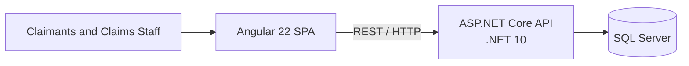

# Plan

## High-Level Architecture

One SPA, one backend, and one database. No Kafka or service split.

## Implementation Plan

### Define

- [x] Agree the high-level architecture.
- [ ] Define the MVP scope and priorities.
- [ ] Define identity and authorization.
- [ ] Define the domain and data model.
- [ ] Define the API contract.
- [ ] Define the backend architecture.
- [ ] Define the frontend architecture.
- [ ] Define the monorepo structure.
- [ ] Define the testing strategy.
- [ ] Define logging and observability.
- [ ] Define configuration and secrets handling.

### Set up

- [ ] Create the monorepo.
- [ ] Scaffold applications using official CLIs.
- [ ] Configure coding conventions, shared commands, and quality checks.
- [ ] Set up SQL Server, migrations, and seed data.
- [ ] Set up local environment configuration.
- [ ] Set up Docker for one-command startup.
- [ ] Set up continuous integration.
- [ ] Complete the repository guidance and documentation.

### Build

- [ ] Build the prioritised backend features.
- [ ] Build the matching frontend features.
- [ ] Add automated tests alongside each feature.
- [ ] Add the component catalogue if useful.
- [ ] Add end-to-end coverage for critical journeys.

### Verify and deliver

- [ ] Verify clean setup and one-command startup.
- [ ] Verify the production builds.
- [ ] Run all quality checks and tests.
- [ ] Review accessibility and security.
- [ ] Review the delivered scope and trade-offs.
- [ ] Prepare the walkthrough.
