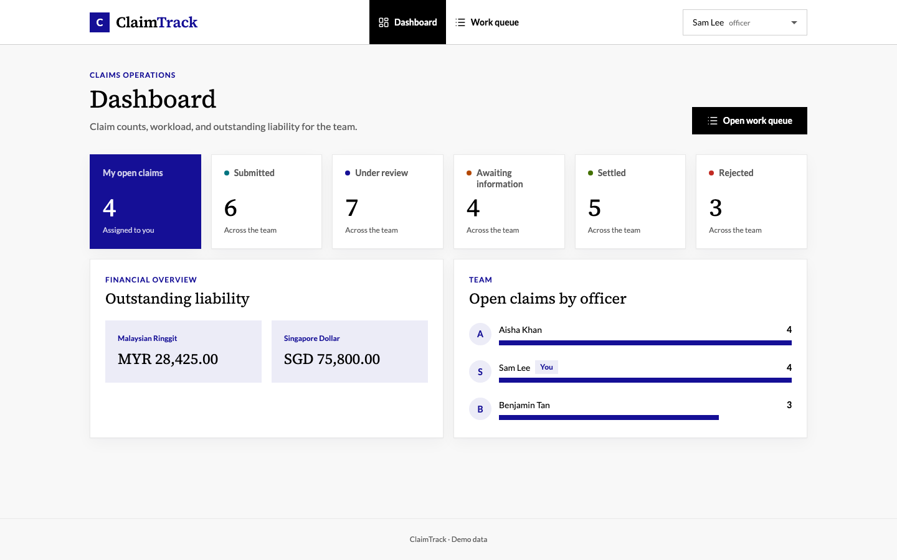

# Claims Platform

ClaimTrack is a claims-management MVP for the Chubb APAC take-home assessment. It gives claimants a way to submit and follow claims, while claims officers can manage work, request information, record liability, and make decisions.



See [all UI screenshots](docs/generated/ui-screenshots.md) at laptop and phone sizes.

## Capabilities

- Claimants submit motor or property claims, track progress, and answer requests for information.
- Claims officers filter the work queue, take ownership, estimate liability, and settle or reject claims.
- The dashboard summarises workload and outstanding liability by currency.
- The API enforces role and ownership rules, valid workflow transitions, validation, and optimistic concurrency.

## Technology

- Angular 22, TypeScript, Angular Material/CDK, and Tailwind CSS 4
- ASP.NET Core Minimal APIs, C# 14, and Entity Framework Core 10
- SQL Server 2025
- OpenAPI-generated frontend client
- Vitest and xUnit

The system is one SPA, one API, and one database. REST keeps the request-driven MVP simple; asynchronous messaging is deferred until there is a concrete integration or throughput need.

## Repository

```sh
apps/
├── api/
│   ├── src/Claims.Api/             # Minimal API, domain, and persistence
│   └── tests/                      # Unit and SQL Server integration tests
└── web/
    └── src/app/
        ├── core/                   # Identity and API infrastructure
        ├── features/               # Claims and dashboard slices
        ├── layout/                 # Application shell and error pages
        └── shared/                 # Reusable UI and formatting
docs/
├── design/                         # Domain, contract, architecture, and flows
├── generated/                      # Regenerable ERD and UI screenshots
└── reference/                      # Original assessment source
tools/                              # ERD and screenshot generators
.vscode/tasks.json                  # Editor entry points for shared commands
Claims.slnx                         # API and test solution
docker-compose.yml                  # Local SQL Server
package.json                        # Shared commands
```

See [monorepo structure](docs/design/monorepo-structure.md) for ownership and boundaries.

## Prerequisites

- macOS or Linux
- [nvm](https://github.com/nvm-sh/nvm), Node.js 26, and npm 11
- .NET SDK 10.0.402, pinned by [`global.json`](global.json)
- Docker Desktop

Select the pinned Node.js version and trust the local HTTPS certificate:

```sh
nvm use
dotnet dev-certs https --trust
```

## Set up

Install all application and tooling dependencies:

```sh
npm ci
npm --prefix apps/web ci
npm --prefix tools/database-erd ci
npm --prefix tools/ui-screenshots ci
dotnet restore Claims.slnx
dotnet tool restore
```

Create the local environment file and start SQL Server:

```sh
cp .env.example .env
docker compose up -d sqlserver
```

The defaults expose SQL Server on `localhost:1433` and store its data in a Docker volume. Apple Silicon runs the x86-64 SQL Server image through emulation.

## Run locally

Start the API:

```sh
npm run start:api
```

Development startup migrates the database and loads [repeatable demo data](docs/development-seed-data.md). The API is available at <https://localhost:5001>; its OpenAPI document is at <https://localhost:5001/openapi/v1.json>.

In another terminal, start the SPA:

```sh
npm run start:web
```

Open <http://localhost:4200>. Use the header switcher to move between seeded claimant and officer users. VS Code users can run **Start App** to start SQL Server, the API, and the SPA.

## Commands

Run commands from the repository root. Focused variants such as `lint:web`, `lint:api`, `test:web`, `test:api:unit`, `build:web`, and `build:api` are also available in [`package.json`](package.json).

```sh
npm run typecheck     # Type-check the SPA without a build
npm run lint          # ESLint plus .NET analyzer and code-style checks
npm run format:check  # Check Prettier and .NET whitespace formatting
npm test              # Frontend, backend unit, and backend integration tests
npm run build         # Production SPA build and warning-free .NET build
npm run check         # Run every quality check above
```

Backend integration tests and `npm run check` require SQL Server and `.env`. Integration tests create and remove their own database. Use `npm run lint:fix` and `npm run format` to apply available automatic fixes.

Common commands are also exposed as descriptive [VS Code tasks](.vscode/tasks.json).

## Generated artifacts

With the migrated database and `.env` available, regenerate the [database ERD](docs/generated/database-erd.md):

```sh
npm --prefix tools/database-erd run generate
```

With the full stack running, regenerate the [UI screenshots](docs/generated/ui-screenshots.md):

```sh
npm --prefix tools/ui-screenshots run install:browser
npm --prefix tools/ui-screenshots run generate
```

The Chromium install is needed only once. Set `UI_BASE_URL` when the SPA is not running at <http://localhost:4200>.

## Documentation

- [Assessment brief](docs/BRIEF.md): source requirements and evaluation context
- [Implementation plan](docs/PLAN.md): delivered scope and remaining work
- [Domain model](docs/design/domain-model.md): entities, workflow, constraints, and concurrency
- [API contract](docs/design/api-contract.md): endpoints, identity headers, errors, and payloads
- [Frontend architecture](docs/design/frontend-architecture.md) and [backend architecture](docs/design/backend-architecture.md): structure and technical decisions
- [Screens and user flows](docs/design/screens-and-user-flows.md): routes, states, and claimant and officer journeys
- [Roles and permissions](docs/design/roles-and-permissions.md): capability and data-visibility matrix
- [Monorepo structure](docs/design/monorepo-structure.md): ownership and boundaries
- [Contributing guide](CONTRIBUTING.md): coding, testing, and quality conventions
- [AI working journal](AI_JOURNAL.md): prompts, decisions, challenges, and reasoning

The MVP intentionally defers production authentication, messaging, file uploads, notifications, payments, CI/CD, and cloud deployment. See the [plan](docs/PLAN.md#mvp-scope) for the complete boundary.
