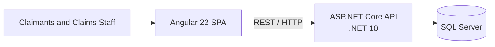

# Plan

## High-Level Architecture

One SPA, one backend, and one database. No Kafka or service split.

## Implementation Plan

### Define

- [x] Agree the high-level architecture.
- [x] Define the MVP scope and priorities.
- [x] Define the [domain and data model](design/domain-model.md).
- [x] Define the [API contract](design/api-contract.md).
- [x] Define the [screens and user flows](design/screens.md).
- [x] Define the [monorepo structure](design/monorepo-structure.md).
- [x] Define the [frontend architecture](design/frontend-architecture.md).
- [x] Define the [backend and database architecture](design/backend-architecture.md).
- [x] Define the testing strategy for the [backend](design/backend-architecture.md#testing), [frontend, and end-to-end journeys](design/frontend-architecture.md#testing).
- [ ] Define identity and authorization.
- [ ] Define logging and observability.
- [ ] Define configuration and secrets handling.

### Set up

- [ ] Create the monorepo.
- [ ] Scaffold applications using official CLIs.
- [ ] Configure coding conventions, shared commands, and quality checks.
- [ ] Set up SQL Server, migrations, and seed data.
- [ ] Set up local environment configuration.
- [ ] Set up Docker for one-command startup.
- [ ] Set up continuous integration.
- [ ] Complete the repository guidance and documentation.

### Build

- [ ] Build the prioritised backend features.
- [ ] Build the matching frontend features.
- [ ] Add automated tests alongside each feature.
- [ ] Add the component catalogue if useful.
- [ ] Add end-to-end coverage for critical journeys.

### Verify and deliver

- [ ] Verify clean setup and one-command startup.
- [ ] Verify the production builds.
- [ ] Run all quality checks and tests.
- [ ] Review accessibility and security.
- [ ] Review the delivered scope and trade-offs.
- [ ] Prepare the walkthrough.

## MVP Scope

### Must have

- Submit a motor or property claim and receive a reference.
- Track claim details, status, and history.
- View the staff work queue and take ownership of a claim.
- Paginate the claimant and staff claim lists.
- Record estimated liability.
- Request and provide additional information as text.
- Settle or reject a claim with a recorded decision.
- Show workload counts and total outstanding liability.
- Enforce valid workflow transitions and input validation.
- Test the important backend rules.
- Provide a thin Angular UI for the core journey.

### Should have

- Queue filter and sort controls.
- Workload breakdowns and basic performance indicators.
- A polished, responsive, and accessible UI.
- Broader component and end-to-end test coverage.

### Deferred

- Production authentication.
- File uploads.
- Notifications and payments.
- Complex reporting and market-specific rules.
- Kafka and external integrations.
- Production cloud deployment.
