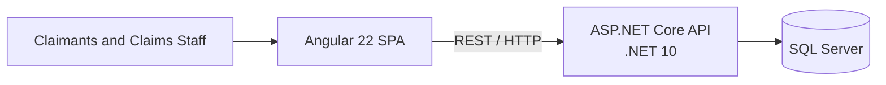

# Plan

## High-Level Architecture

One SPA, one backend, and one database. No Kafka or service split.

## Implementation Plan

### Define

- [x] Agree the high-level architecture.
- [x] Define the MVP scope and priorities.
- [x] Define the [domain and data model](design/domain-model.md).
- [x] Define the [API contract](design/api-contract.md).
- [x] Define the [screens and user flows](design/screens-and-user-flows.md).
- [x] Define the [monorepo structure](design/monorepo-structure.md).
- [x] Define the [frontend architecture](design/frontend-architecture.md).
- [x] Define the [backend and database architecture](design/backend-architecture.md).
- [x] Define the testing strategy for the [backend](design/backend-architecture.md#testing), [frontend, and end-to-end journeys](design/frontend-architecture.md#testing).
- [x] Define [roles and permissions](design/roles-and-permissions.md) and [identity and authorization](design/backend-architecture.md#platform-concerns).
- [x] Define [logging and observability](design/backend-architecture.md#platform-concerns).
- [x] Define [configuration and secrets handling](design/backend-architecture.md#platform-concerns).

### Set up

- [x] Establish initial repository guidance in `AGENTS.md` and `CONTRIBUTING.md`.
- [x] Create the monorepo.
- [x] Scaffold applications using official CLIs.
- [x] Set up local SQL Server and environment configuration.
- [x] Configure coding conventions, shared commands, and quality checks.
- [ ] Containerize the SPA and API and establish Docker Compose startup.
- [ ] Set up pre-commit hooks.

### Build

- [x] Implement database persistence, migrations, and development seed data.
- [x] Build the prioritised backend features.
- [x] Build the matching frontend features.
- [x] Add tests alongside each feature, with end-to-end coverage for critical journeys.

### Verify and deliver

- [x] Complete the README and supporting documentation.
- [ ] Verify clean setup, production builds, and all checks.
- [ ] Review the delivered scope and trade-offs.
- [ ] Prepare the walkthrough.

## MVP Scope

### Must have

- Submit a motor or property claim and receive a reference.
- Track claim details, status, and history.
- View the staff work queue and take ownership of a claim.
- Paginate the claimant and staff claim lists.
- Record estimated liability.
- Request and provide additional information as text.
- Settle or reject a claim with a recorded decision.
- Show workload counts and total outstanding liability.
- Enforce valid workflow transitions and input validation.
- Test the important backend rules.
- Provide a thin Angular UI for the core journey.

### Should have

- Queue filter and sort controls.
- Workload breakdowns and basic performance indicators.
- A polished, responsive, and accessible UI.
- Broader component and end-to-end test coverage.

### Won't have

- Production authentication.
- File uploads.
- Notifications and payments.
- Complex reporting and market-specific rules.
- Kafka and external integrations.
- Component catalogue.
- Dedicated accessibility and security work beyond framework defaults.
- Continuous integration.
- Production cloud deployment.
