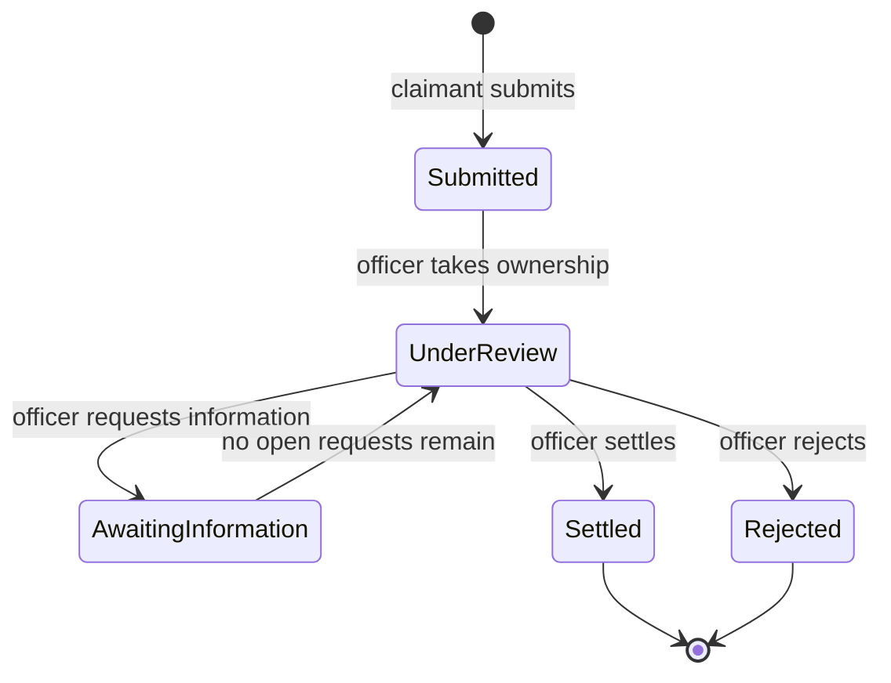
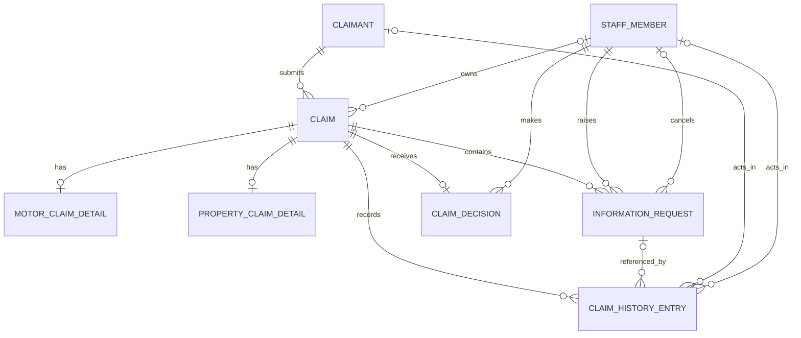

# Domain and Data Model

## Domain

`Claim` is the aggregate root. It owns the workflow, assignment, liability estimate, information requests, decision, and history. A `Claimant` can submit and track claims; a claims officer takes ownership and assesses them.

### Enums

- `ClaimType`: `Motor`, `Property`.
- `ClaimStatus`: `Submitted`, `UnderReview`, `AwaitingInformation`, `Settled`, `Rejected`.
- `ClaimDecisionOutcome`: `Settled`, `Rejected`.
- `InformationRequestStatus`: `Open`, `Answered`, `Cancelled`.
- `ClaimHistoryEventType`: `Submitted`, `OfficerAssigned`, `EstimatedLiabilityUpdated`, `InformationRequested`, `InformationProvided`, `InformationRequestCancelled`, `Settled`, `Rejected`.
- `ClaimHistoryActorType`: `Claimant`, `ClaimsOfficer`, `System`.

Currency uses configurable ISO 4217 codes rather than an enum.

### Lifecycle

### Rules

1. A claim has exactly one type and one matching motor or property detail record.
2. Only an unassigned `Submitted` claim can be taken. Assignment and the move to `UnderReview` happen atomically.
3. Only the assigned officer can update liability, request information, or decide the claim. Review and liability updates remain available while awaiting information.
4. A claim may have several open information requests. The assigned officer may cancel an open request. The claim remains `AwaitingInformation` until every request is answered or cancelled, then returns to `UnderReview`.
5. Money cannot be negative and uses the claim's currency. Outstanding liability is the sum of estimates for non-terminal claims; a missing estimate contributes zero.
6. Settlement requires an estimate, settlement amount, and rationale. Rejection requires a rationale. Both terminal states are final in the MVP.
7. Every material change appends an immutable history entry in the same transaction as the change.

In the MVP, claimants and staff are seeded, and a claimant is identified by email, assumed verified. User management is deferred.

## Relational model

Entity Framework Core will map the domain and create migrations, but the database shape remains an explicit design decision.

### Tables

`Claims`

- `Id` (`uniqueidentifier`, primary key) and `Reference` (unique, high-entropy public tracking identifier).
- `ClaimantId` foreign key to `Claimants`.
- `Type` (`ClaimType`), `Status` (`ClaimStatus`), and `PolicyNumber`.
- `IncidentAt`, `IncidentLocation`, and `IncidentDescription`.
  - These can be grouped as a claim-owned `IncidentDetails` value object in C# while remaining columns in `Claims`.
- Nullable `AssignedOfficerId` foreign key to `StaffMembers`.
- Nullable `EstimatedLiability` (`decimal(19,4)`) and non-null ISO 4217 `CurrencyCode`.
- `SubmittedAt`, `UpdatedAt`, and `Version` (`rowversion`) for concurrency.

`Claimants`

- `Id`, unique `Email`, `FullName`, nullable `Phone`, and `CreatedAt`.
- Seeded demo claimants for the MVP; later linked to the chosen identity provider.

`StaffMembers`

- `Id`, unique `Email`, `DisplayName`, and `IsActive`.
- Seeded demo officers for the MVP; later linked to the chosen identity provider.

`MotorClaimDetails`

- `ClaimId` is both the primary key and foreign key to `Claims`.
- `VehicleRegistration`.

`PropertyClaimDetails`

- `ClaimId` is both the primary key and foreign key to `Claims`.
- `PropertyAddress`.

The domain ensures that a claim has exactly one detail row matching `Claims.Type`. Separate tables avoid a wide claim row containing unrelated nullable fields.

`InformationRequests`

- `Id`, `ClaimId`, `RequestedById`, `RequestText`, `RequestedAt`, and `Status` (`InformationRequestStatus`).
- Nullable `ResponseText` and `RespondedAt`, plus nullable `CancelledById`, `CancelledAt`, and `CancellationReason`.
- `RequestText` and `ResponseText` are plain text in the MVP; HTML and file attachments are not supported.
- An answered request has response fields only; a cancelled request has cancellation fields only. Only an `Open` request can be answered or cancelled.

`ClaimDecisions`

- `ClaimId` is both the primary key and foreign key, enforcing one decision per claim.
- `DecidedById`, `Outcome` (`ClaimDecisionOutcome`), nullable `SettlementAmount`, `Rationale`, and `DecidedAt`.
- `SettlementAmount` is required only for `Settled`. `Outcome` and terminal `Claims.Status` must agree and are written in one transaction.

`ClaimHistoryEntries`

- `Id`, `ClaimId`, `EventType` (`ClaimHistoryEventType`), `Summary`, `ActorType` (`ClaimHistoryActorType`), nullable `ActorClaimantId`, nullable `ActorStaffMemberId`, and `OccurredAt`.
- Nullable `InformationRequestId` links request-related events to the affected request. A composite foreign key on `(ClaimId, InformationRequestId)` to a unique `InformationRequests(ClaimId, Id)` ensures the request belongs to the same claim.
- Nullable `Details` (`json`) stores event-specific values, such as the previous and new liability.
- `ActorClaimantId` is required for claimant events; `ActorStaffMemberId` is required for claims-officer events; both are null for system events.
- The application does not rebuild a claim from its history entries. Current status, assigned officer, and estimated liability are read directly from `Claims`; history entries provide the user-visible timeline.

### Storage decisions

- Target SQL Server 2025 and use its native `json` type for `Details`. Set the database compatibility level to 170 and configure the EF Core 10 SQL Server provider to match.
- Persist enums as strings. Use database check constraints for:
  - allowed enum values and non-negative money;
  - an assigned officer if and only if the status is not `Submitted`, and an estimate on `Settled` claims;
  - three-letter uppercase currency codes and an incident no later than submission;
  - valid information-request field combinations, and a settlement amount if and only if the outcome is `Settled`; and
  - the actor ID required by each history actor type, and the request ID required by request events.
- Keep searchable and relational data in normal columns. `Details` contains only structured event data that varies by event type and excludes sensitive claim text.
- Store timestamps as UTC `datetimeoffset` and money as `decimal(19,4)`.
- Enforce rules in the database wherever SQL Server can express them with primary and foreign keys, unique constraints, required columns, and check constraints. Mirror them in the domain for earlier, clearer errors. Cross-table rules—such as matching claim details, decision outcome and claim status—plus permissions remain transactional application rules.
- Add only indexes that support MVP queries:
  - unique `Claims(Reference)` for claim lookup;
  - `Claims(ClaimantId, SubmittedAt)` for a claimant's claims;
  - `Claims(Status, SubmittedAt)` for the incoming queue and status counts;
  - `Claims(AssignedOfficerId, Status, UpdatedAt)` for an officer's workload;
  - `ClaimHistoryEntries(ClaimId, OccurredAt)` for the claim timeline; and
  - `InformationRequests(ClaimId, Status)` for open requests.
- Use `Version` for optimistic concurrency. Updates include the version originally read; if another request changed the claim first, no row matches and EF Core raises a concurrency exception. Roll back the transaction and return `409 Conflict` with the latest claim rather than silently overwriting or retrying the action. Every action updates `Claims.UpdatedAt`, so the claim's `Version` also guards its information requests.
- Foreign keys use `NO ACTION` on delete, so history is never removed by a cascade; staff are deactivated, not deleted.
- Query `Claims` directly for queue counts and outstanding liability until scale shows that a separate read model is necessary.
- Keep claim operations synchronous: update the current state and append its history entry in one database transaction. Kafka and event-driven processing are deferred until an asynchronous integration, such as notifications, requires them.

## Deferred

- User management and sign-up.
- Attachments.
- Policy validation.
- Payments and notifications.
- Fraud checks.
- Reserve line items.
- Reassigning claims and reopening decisions.
- Market-specific rules.
- Multi-party claims.
