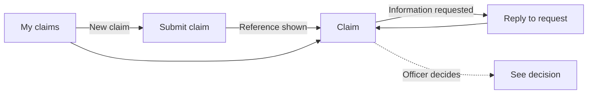
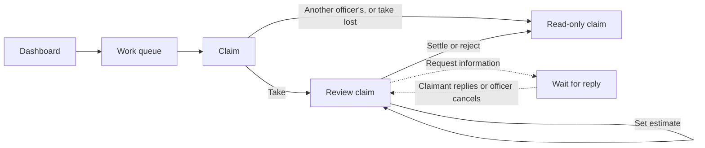

# Screens and User Flows

## Principles

- One Angular SPA serves claimants and claims staff; each role sees only its own screens.
- Action buttons are disabled when the user cannot take the action, and while a change is being sent.
- After an action, the screen shows the returned claim, keeps its `ETag` for the next change, and refetches the history.

## Screens

API paths are relative to `/api/v1`.

| Screen | Route | Role | Purpose | API |
| --- | --- | --- | --- | --- |
| Dashboard | `/dashboard` | Officer | Workload counts and outstanding liability. | `GET /dashboard` |
| My claims | `/my-claims` | Claimant | The caller's claims, newest first. | `GET /claims` |
| Submit claim | `/my-claims/new` | Claimant | Motor or property claim form. | `POST /claims` |
| Claim (claimant) | `/my-claims/:reference` | Claimant | Details, status, decision, history, and a reply form for the open information request. | `GET /claims/{reference}`, `GET /claims/{reference}/history`, `POST /claims/{reference}/information-requests/{requestId}/response` |
| Work queue | `/queue` | Officer | Undecided claims, oldest first. Filter and sort controls are should-haves. | `GET /claims` |
| Claim (staff) | `/queue/:reference` | Officer | Details, estimate, history, and the actions below. | `GET /claims/{reference}`, `GET /claims/{reference}/history`, the action endpoints |

`/` redirects to the selected user's home screen: Dashboard for officers, My claims for claimants. Each route is guarded by role.

List screens are paginated and keep the page and page size in the URL.

### User switcher

For the MVP, a switcher in the header picks a seeded claimant or active officer and stands in for sign-in until the identity step. Switching users opens that user's home screen.

The seeded users and the allowed currencies come from frontend configuration, because the API does not list them.

### Staff claim actions

| Action | Enabled when | Input |
| --- | --- | --- |
| Take claim | `Submitted` | |
| Set estimate | Assigned to me; `UnderReview` or `AwaitingInformation` | Amount |
| Request information | Assigned to me; `UnderReview` | Request text |
| Cancel request | Assigned to me; `AwaitingInformation` | Reason |
| Settle | Assigned to me; `UnderReview` with an estimate | Settlement amount, rationale |
| Reject | Assigned to me; `UnderReview` | Rationale |

Claims assigned to another officer, and decided claims, are read-only. Settle and reject ask for confirmation because the decision is final.

### Shared states

| State | Shown when |
| --- | --- |
| Loading | A screen's data is loading. |
| Choose a user | No user is selected; points to the switcher. |
| Not allowed | The route belongs to the other role, or loading returns `403`. |
| Not found | The route is unknown, or loading returns `404`. |
| Coming soon | The route is planned but not built yet, such as a should-have screen left out of the MVP. |
| Something went wrong | Loading fails unexpectedly. Offers a retry. |

### Errors

A failure while loading a screen shows a shared state. A failed action keeps the form and shows the message inline.

| API response | On load | On action |
| --- | --- | --- |
| `400` `validation_failed` | | Show the field errors. |
| `401` | Clear the selected user and show Choose a user. | Same as on load. |
| `403` | Show Not allowed. | Show the message and reload the claim. |
| `404` | Show Not found. | Show the message and reload the claim. |
| `409` | | Show the message and reload the claim, keeping any typed text. |
| Anything else | Show Something went wrong. | Show the message. |

## User flows

### Claimant

### Claims officer

## Deferred

- Accessibility review and hardening.
- Sign-in and sign-up screens.
- File uploads on the submit and reply forms.
- Live updates; the user refreshes the screen.
- Tooltips explaining why a button is disabled.
