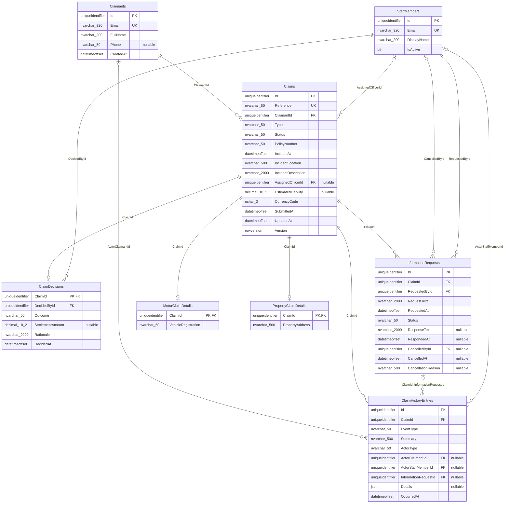

# Database ERD

> Generated from the live SQL Server `Claims` database by `tools/database-erd`. Do not edit this file manually; edit `tools/database-erd/database-erd.template.md` and regenerate instead.

The diagram shows the physical schema only. Domain rules that SQL Server cannot express as foreign keys, such as requiring exactly one detail row matching `Claims.Type`, are documented in the [domain model](../design/domain-model.md).
