# UI Screenshots

> Generated from the running SPA and API by `tools/ui-screenshots`. Do not edit this file manually; edit `tools/ui-screenshots/ui-screenshots.template.md` or the screen list in `generate-screenshots.mjs` and regenerate instead.

Each screen is captured at a standard laptop width (1440 px) and a standard phone width (390 px). Images show the full page, so they are taller than one screen. The data comes from the [development seed data](../development-seed-data.md).

## Claimant

### My claims

A claimant's claims with their status and newest first. `/my-claims`

<table>
  <tr><th>Laptop (1440 px wide)</th><th>Mobile (390 px wide)</th></tr>
  <tr>
    <td valign="top">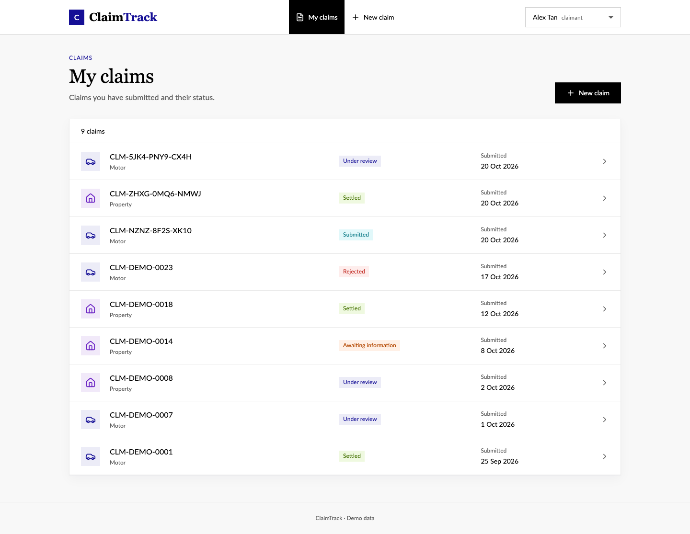</td>
    <td valign="top">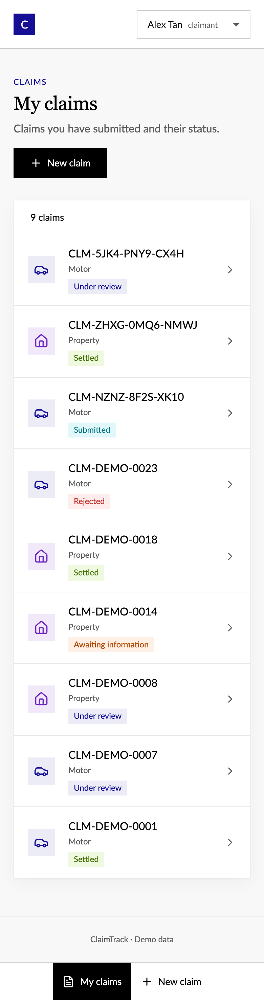</td>
  </tr>
</table>

### Submit a claim

The three-step submission form. `/my-claims/new`

<table>
  <tr><th>Laptop (1440 px wide)</th><th>Mobile (390 px wide)</th></tr>
  <tr>
    <td valign="top">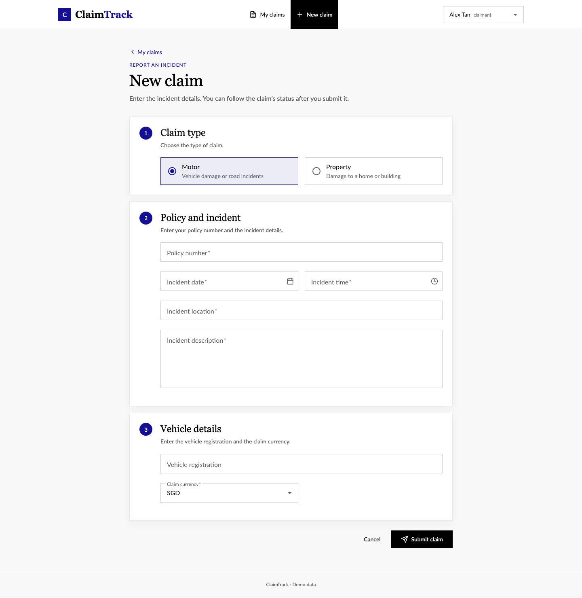</td>
    <td valign="top">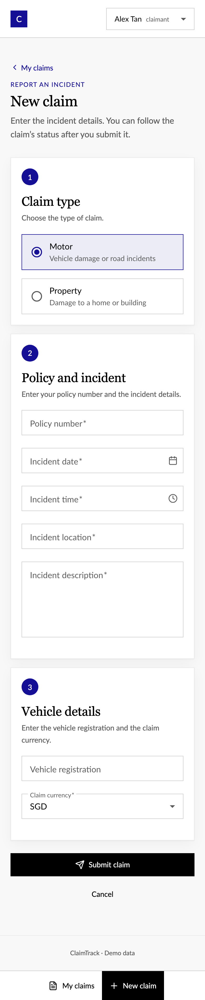</td>
  </tr>
</table>

### Claim awaiting information

An open information request the claimant can answer. `/my-claims/CLM-DEMO-0014`

<table>
  <tr><th>Laptop (1440 px wide)</th><th>Mobile (390 px wide)</th></tr>
  <tr>
    <td valign="top">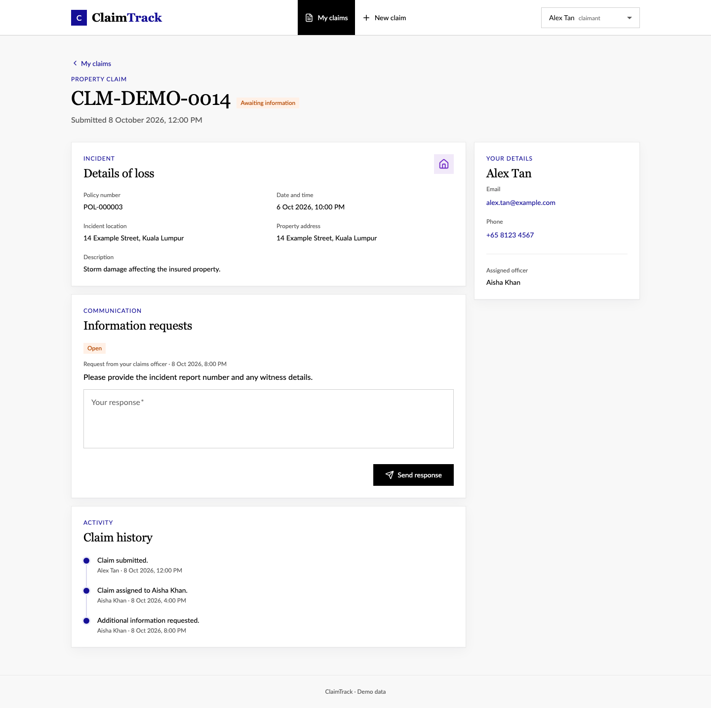</td>
    <td valign="top">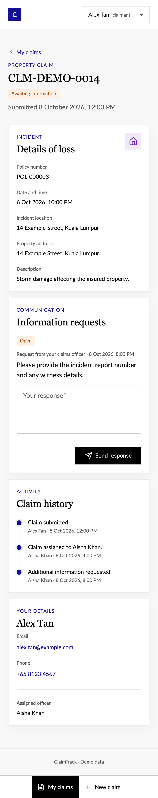</td>
  </tr>
</table>

### Settled claim

A final decision with the settlement amount and history. `/my-claims/CLM-DEMO-0018`

<table>
  <tr><th>Laptop (1440 px wide)</th><th>Mobile (390 px wide)</th></tr>
  <tr>
    <td valign="top">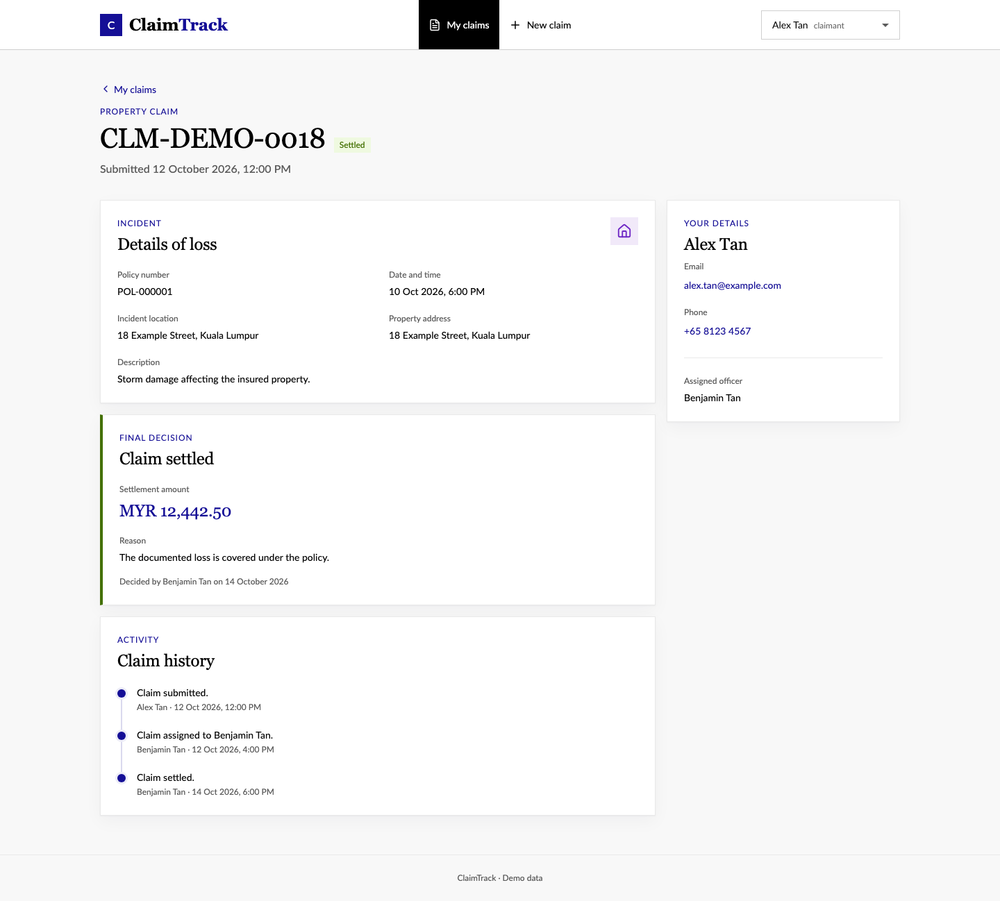</td>
    <td valign="top">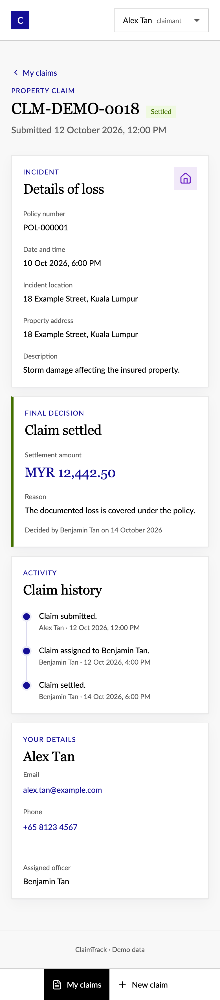</td>
  </tr>
</table>

## Claims officer

### Dashboard

Team claim counts, workload, and outstanding liability. `/dashboard`

<table>
  <tr><th>Laptop (1440 px wide)</th><th>Mobile (390 px wide)</th></tr>
  <tr>
    <td valign="top"></td>
    <td valign="top">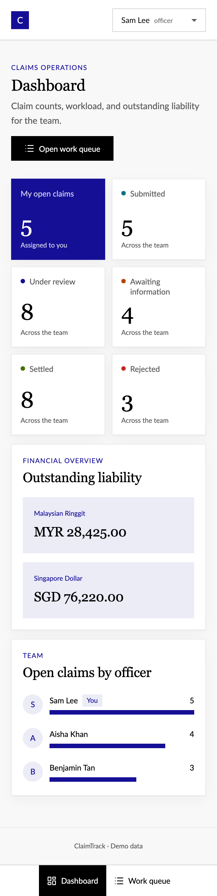</td>
  </tr>
</table>

### Work queue

Open claims with server-side filters, sorting, and paging. `/queue`

<table>
  <tr><th>Laptop (1440 px wide)</th><th>Mobile (390 px wide)</th></tr>
  <tr>
    <td valign="top">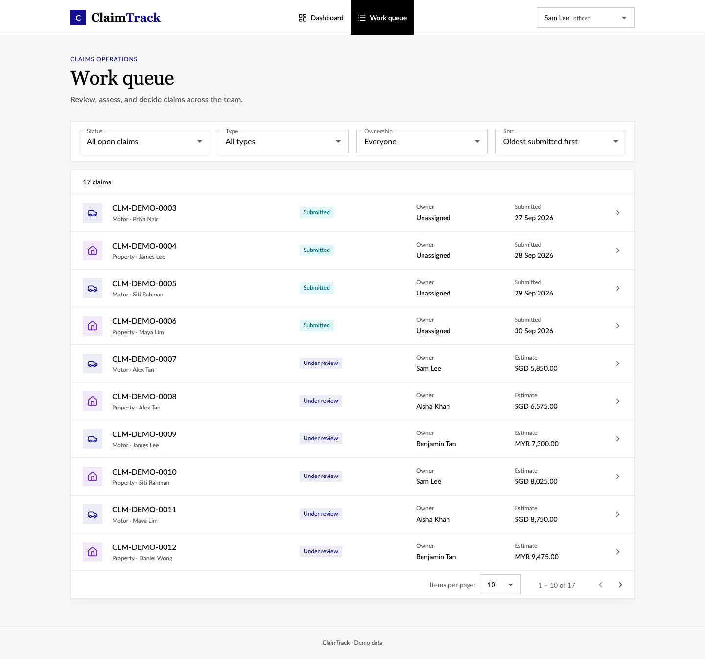</td>
    <td valign="top">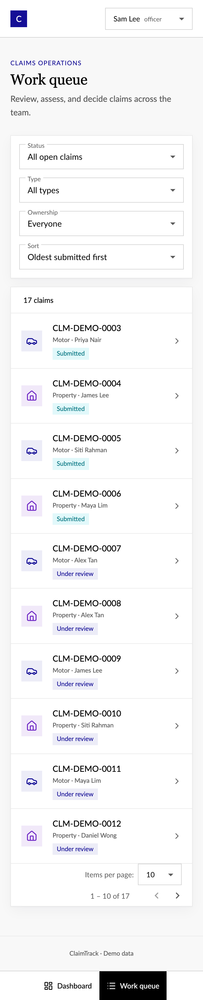</td>
  </tr>
</table>

### Claim review

An owned claim with estimate, information request, and decision actions. `/queue/CLM-DEMO-0007`

<table>
  <tr><th>Laptop (1440 px wide)</th><th>Mobile (390 px wide)</th></tr>
  <tr>
    <td valign="top">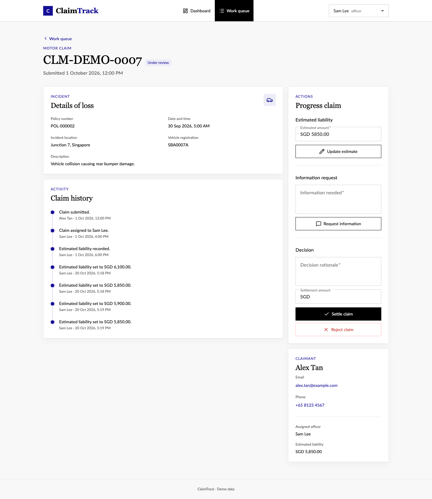</td>
    <td valign="top">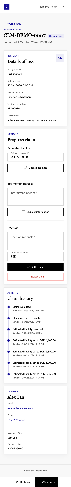</td>
  </tr>
</table>
